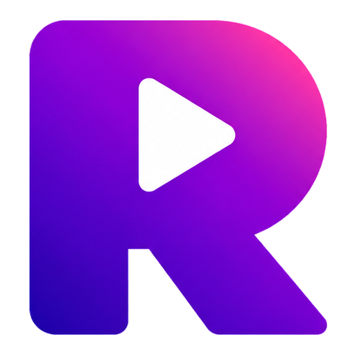

<p align="center"></p>

# Reelator

캡컷 스타일의 개인용 영상 편집기.

- **폰 (안드로이드)**: 웹앱(PWA) — https://betanogo.github.io/Reelator/ 를 크롬으로 열고 ‘홈 화면에 추가’
- **PC (Windows)**: Electron 데스크톱 앱 — 아래 설치 참고

## 폰 앱 (mobile/)

- 캡컷 모바일과 같은 세로 화면: 가운데 고정 플레이헤드, 손가락으로 스크롤해서 탐색, 두 손가락으로 확대/축소
- 미디어는 앱 저장소(OPFS)에 복사돼서 프로젝트가 자동 저장되고 다시 열 수 있어요
- 내보내기는 폰의 하드웨어 인코더(WebCodecs, Mediabunny)로 MP4를 만들고, 공유 버튼으로 갤러리 저장이나 메신저 전송
- 트랜지션, 필터, 조정, 화면, 볼륨, 페이드, 비율, 배경은 PC 버전과 같은 엔진을 그대로 써요

```bash
npm run mobile:dev     # 폰에서 같은 와이파이로 접속해 테스트 (host 노출)
npm run mobile:build   # mobile/dist
```

## PC 설치

[Releases](../../releases)에서 `Reelator-Setup-x.y.z.exe`를 받아 실행하세요.
코드 서명이 없어서 Windows SmartScreen이 뜨면 **추가 정보 → 실행**을 누르면 돼요.

## 현재 기능 (v0.1)

- 미디어 가져오기: 영상, 사진, GIF, 음악 (버튼 또는 탐색기에서 끌어다 놓기)
- 메인 트랙 (캡컷처럼 자석식): 끌어서 순서 바꾸기, 양끝 핸들로 자르기, 분할, 삭제
- 오디오 트랙: 배경음악, 위치 이동, 자르기, 페이드 인/아웃
- 트랜지션 20종: 디졸브, 블랙 페이드, 화이트 플래시, 와이프, 원형 열기, 슬라이드 4종, 밀어내기 2종,
  휙 패닝, 줌 인/아웃, 회전, 블러, 픽셀화, 글리치, 물결, 스플릿, 하트
- 필터 26종 + 세기 조절, 조정 11종 (밝기, 대비, 채도, 색온도, 색조, 하이라이트, 그림자, 페이드, 선명도, 비네팅, 그레인)
- 화면: 비율 (16:9, 9:16, 1:1, 4:3, 3:4, 21:9), 맞춤/채우기, 크기, 위치, 회전, 배경색
- 실행 취소 / 다시 실행, 프로젝트 저장 (`.reelator`)
- MP4 내보내기: 720p ~ 4K, 24 ~ 60fps, H.264 + AAC

## 단축키

| 키 | 동작 |
| --- | --- |
| Space | 재생 / 일시정지 |
| S, Ctrl+B | 플레이헤드 위치에서 분할 |
| Delete | 선택 삭제 |
| Ctrl+Z / Ctrl+Y | 실행 취소 / 다시 실행 |
| ← → | 1프레임 이동 (Shift: 1초) |
| Home / End | 처음 / 끝 |
| Ctrl + 휠, + / - | 타임라인 확대 / 축소 |
| Ctrl+S, Ctrl+Shift+S | 저장, 다른 이름으로 저장 |
| Ctrl+O | 열기 |
| Ctrl+E | 내보내기 |
| F12 | 개발자 도구 |

## 구조

```
src/main/        Electron 메인 프로세스: 창, 파일 대화상자, reel:// 미디어 프로토콜, FFmpeg (분석, 썸네일, 인코딩)
src/preload/     렌더러에 노출하는 안전한 API (window.reelator)
src/renderer/
  model/         프로젝트 데이터, 타임라인 계산, 상태 저장소 (zustand, 실행 취소)
  engine/
    compositor   WebGL2 합성기: 클립 패스 (맞춤/변형/필터) → 트랜지션 패스
    transitions  트랜지션 = GLSL 함수 하나. 배열에 추가하면 끝
    filters      필터 프리셋 = 파라미터 묶음
    preview      재생 엔진 (video/audio 요소 동기화)
    exporter     프레임 단위 렌더 → 메인 프로세스의 FFmpeg로 전송
  components/    UI
```

트랜지션 추가: `src/renderer/engine/transitions.ts`의 `TRANSITIONS`에 항목 하나를 추가하면 목록, 미리보기, 내보내기에 모두 반영돼요.

## 개발

```bash
npm install
npm run dev          # 개발 모드
npm run typecheck
npm run dist         # Windows 설치 파일 (release/)
npm run test:export -- <audio-or-video files>   # FFmpeg 내보내기 파이프라인 테스트
```

`main`에 푸시하면 GitHub Actions가 Windows 설치 파일을 빌드하고, `v*` 태그를 붙이면 Release로 올라가요.
